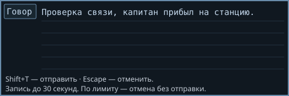

# Офлайн-диктовка в TGUI Primera

Речь распознаётся локально в Web Worker. Сервер получает только готовый текст через штатный Say; игровые ограничения речи остаются в силе. Обычный T сохраняет клавиатурный ввод. Облачных речевых API нет.

## Для игрока: как включить

1. Установить **Windows BYOND 516.1685 или 516.1688 (x86)**. Другие версии клиентского патча не поддерживаются.
2. Скачать ZIP установщика из [Byond-Mic-Patch Releases](https://github.com/TheSameEli/Byond-Mic-Patch/releases/latest), распаковать, закрыть все приложения BYOND, включая значок в трее. Запустить `Byond-Mic-Patch.exe`, подтвердить права администратора, выбрать свою папку BYOND/bin и нажать «Установить патч».
3. Подключиться к серверу. Открыть **Настройки игры → Звук → Диктовка — микрофон и проверка**. Нажать «Разрешить микрофон», подтвердить штатный запрос WebView2 и выбрать устройство.
4. Запустить **«Тест на 10 секунд»**. Дождаться распознанного текста; тест не отправляет речь в чат. Первое получение модели с сервера может занять дополнительное время.
5. В игре нажать **Shift+T** — начнётся диктовка в штатном поле Say на пять строк. Повторное **Shift+T** остановит запись и отправит распознанный текст. **Escape** отменит без отправки.

Схема поля ниже показывает расположение элементов, это не скриншот записи:

**Лимит — 30 секунд фактической записи; при достижении лимита запись отменяется без отправки.** Загрузка модели в лимит не входит. Если остановить подготовку до готовности модели, микрофон после загрузки сам не включится: нажать клавишу диктовки снова. Отпускание клавиш ничего не отправляет.

Переназначение: **Настройки → Управление → Общение → «Диктовка: начать / отправить»**. Сохранённые сочетания применяются сразу и для начала записи с карты, и для отправки из поля. Крестик в настройках закрывает настройки; поле диктовки отменяется через Escape.

## Откат клиентского патча

Закрыть BYOND, открыть `Byond-Mic-Patch.exe`, выбрать ту же папку и нажать **«Восстановить BYOND»**. Альтернатива — `Restore-Patch.cmd` от имени администратора. Патч хранит оригинал в `byondwin.dll.before-microphone-patch` рядом с DLL; не удалять эту копию до отката.

Полные инструкции, исходники и контрольные суммы клиента: [TheSameEli/Byond-Mic-Patch](https://github.com/TheSameEli/Byond-Mic-Patch). Патч меняет принудительный отказ в доступе к микрофону на штатный запрос разрешения. Он не включает микрофон без согласия пользователя и не расширяет разрешения камеры/геолокации. После обновления BYOND DLL может замениться: неизвестная версия не патчится.

## Установка на сервер

1. Применить исходники PR к Primera и установить зависимости TGUI из lock-файла.
2. В действующем `config/config.txt` включить отдельной строкой `TGUI_SAY_SPEECH`. При отсутствии флага прежний клавиатурный ввод сохраняется.
3. Собрать и перезапустить сервер штатным `BUILD.cmd` или `bin/build.cmd`; игрокам переподключиться для обновления TGUI.
4. Дать игрокам ссылку на клиентский патч и шаги выше. Без поддержки микрофона обычный ввод T остаётся доступен.

Модель включена в `html/speech/vosk-model-small-ru-0.22.tar.gz`, передаётся только при первом использовании распознавания. Для воспроизведения/обновления именно этого архива: `python tools/speech/prepare_model.py`. Скрипт скачивает исходный ZIP и проверяет SHA256 перед перепаковкой. Это подготовка ресурса, а не облачное распознавание.

## Модель, ресурсы и лицензии

- [vosk-model-small-ru-0.22](https://alphacephei.com/vosk/models), Alpha Cephei, Apache-2.0. Веса не изменены; архив перепакован с явными каталогами для браузерного загрузчика.
- [vosk-browser 0.0.8](https://github.com/ccoreilly/vosk-browser), Ciaran O'Reilly, Apache-2.0. Движок включён в bundle TGUI.
- Текст Apache-2.0: [LICENSE-2.0.txt](LICENSE-2.0.txt).
- Архив модели — 46 224 298 байт (44,1 МиБ), движок в bundle TGUI — около 6 МиБ. Модель остаётся в памяти до закрытия клиента/страницы.
- Ориентир дополнительной RAM — 300–400 МиБ; CPU зависит от устройства. Это оценка, а не гарантированный бюджет полноценного раунда Primera. В момент обработки worker может заметно загружать одно логическое ядро.

## Проверка

Локальная сборка Primera на Windows/BYOND 516.1685 с отдельным микрофонным патчем принята пользователем после проверки в игре. Сборка DM и TGUI, TypeScript, lint и DreamChecker выполняются отдельно от этой ручной приёмки. Автоматические тесты по запросу пользователя не запускались.

Для дальнейшей ручной проверки: короткий T; начало/отправка диктовки; Escape при загрузке и записи; отказ микрофона; переоткрытие настроек; десятисекундный тест без отправки; переназначение сочетания; лимит 30 секунд; ограничения речи немого/мёртвого персонажа и mute. Этот перечень не означает, что каждый сценарий отдельно подтверждён.
